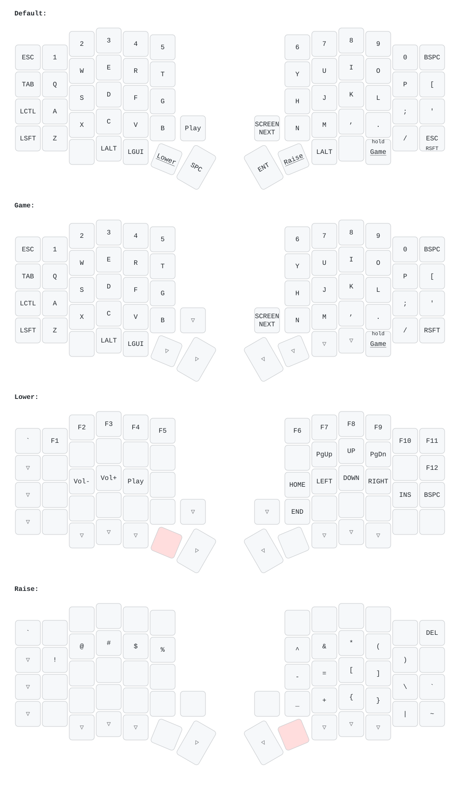

# mdjarv: Aurora Sofle v2 with a Liatris

| File | Holds |
|---|---|
| `keymap.json` | Layers, encoders, the Liatris converter and every standard setting (features, tap-hold, debounce, split sync). Layers are numbered here; `layers.h` names them for C. Run `make draw` after changing it to redraw `keymap.svg`. |
| `keymap.c` | Behaviour: hold-to-toggle game mode, next OLED screen, Liatris LED off |
| `oled.c`, `gfx/` | OLED entry point and the animations |
| `screens.c`, `fb.c` | Left OLED screens, drawn into a framebuffer |
| `hostdata.c`, `hostdata.h` | Raw HID reports from `tools/kbscreen` and their byte layout |
| `config.h`, `rules.mk` | Only what `keymap.json` cannot express |

Behaviour worth knowing:

- **Game mode** (default layer 1) toggles after holding the outer right thumb key for 0.5 s, so a brushing palm does not switch it. The right OLED shows the amazed face instead of the headphones while it is on.
- **Esc / Right Shift** is one mod-tap key. Permissive hold makes pressing and releasing another key while it is down count as Shift.
- **Knobs**: left is volume, right is scroll; both do nothing on Lower. Pressing the right knob shows the next left-OLED screen.
- **Debounce** is `asym_eager_defer_pk` at 10 ms: presses register at once, releases wait 10 ms of stable contact, which swallows switch chatter.
- **Left OLED** shows what `tools/kbscreen` sends from the computer. An agent waiting on you shows the agent board; otherwise music playing shows the music screen; otherwise perf: line graphs of the last 32 s of CPU, GPU, RAM, temperature and power. A knob press shows the next screen until that choice changes. A volume change shows a volume readout over any screen for 1.5 s. Without data for 3 s the cat comes back.
- **Right OLED** is the top half of the headphones animation (the amazed face in game mode) over the layer icon and the Gui/Alt/Ctrl/Shift tiles.
- **OLEDs** blank after 60 s without input. RGB is off.

The layout came from the Vial backup in `archive/vial-2026-10-21.vil`.
